# Access to Safe Drinking Water: A Data Analysis Portfolio

**Who still lacks safe drinking water, and is it improving?** An end-to-end analysis of WHO/UNICEF Joint Monitoring Programme (JMP) estimates, built around **UN Sustainable Development Goal 6 (clean water and sanitation)**.

- **Part 1, the 2020 snapshot:** 213 countries. Cleaning, feature engineering, descriptive statistics, and access by area, population size and income group.
- **Part 2, change over time:** 231 countries observed in 2015 and (mostly) 2020. Annual Rate of Change (ARC), full-access analysis, rural vs urban gaps and regional progress.

**Slide deck:** [`presentation/water-access-portfolio-deck.pptx`](presentation/water-access-portfolio-deck.pptx) (21 slides; a [PDF copy](presentation/water-access-portfolio-deck.pdf) renders directly on GitHub).

---

## Headline findings

| Finding | Evidence |
|---|---|
| About **768 million** people in the 2020 data lack at least basic drinking water (about 1 in 10) | Sum over countries of (100 - basic access %) x population; approximate |
| **Rural access trails urban by 13.4 points** | Mean basic access: 81.3% rural vs 94.7% urban (national 89.9%). Rural spread (IQR 34.3) is 4.6x the urban spread (7.4) |
| **Income is the sharpest divider** | Basic access 62.8% in low-income vs 99.6% in high-income countries; surface-water reliance 5.4% vs 0.02% |
| **Population size is irrelevant; rurality is not** | r(population, basic access) = 0.00; r(urban share, basic access) = 0.55 |
| **Most countries improved, but not all** | 2015 to 2020, national basic access: 135 improving, 16 unchanged, 16 declining, 62 already at full access, 2 without a value (231 countries) |
| **Rural access grew faster than urban in 68% of countries** | Median ARC gap (rural minus urban) of 0.21 pp per year across 165 countries |
| **Sub-Saharan Africa: fastest gains, furthest to go** | Highest average national ARC (0.56 pp/yr) but lowest basic access (70.4% at end year); 37 of the 44 countries below 80% basic access are there |

---

## Repository layout

```
water-access-portfolio/
├── README.md
├── requirements.txt            Python dependencies
├── package.json                Node dependencies (slide deck builder)
├── data/
│   ├── DATA_DICTIONARY.md      Every column and table explained
│   ├── summary_metrics.json    Headline numbers consumed by the deck builder
│   ├── validation_checks.csv   84 recomputed-vs-workbook checks (all pass)
│   ├── workbooks/              The two original Google Sheets workbooks, exported to .xlsx
│   ├── part1_2020_snapshot/    Cleaned 2020 data + summary tables (CSV)
│   └── part2_arc_2015_2020/    Cleaned panel + ARC, region and gap tables (CSV)
├── plots/
│   ├── original_sheet_exports/ The 8 charts embedded in the workbooks, as exported
│   └── reproduced/             15 clean, consistently styled re-draws of the analysis
├── presentation/               22-slide deck (.pptx) and a PDF copy
└── scripts/
    ├── run_analysis.py         Re-derives all metrics and plots from the workbooks
    └── build_deck.js           Builds the slide deck from the metrics and plots
```

---

## The data

- **Source:** WHO/UNICEF JMP *Estimates on the use of water*. Each country-year has population, urban share and the share of people at four service levels, for national, rural and urban populations (16 original columns).
- **Service ladder (best to worst):** *at least basic* (safely managed + basic) > *limited* > *unimproved* > *surface water*. Shares within an area sum to about 100%.
- **Part 1** uses the 2020 file (213 countries). **Part 2** uses the same WHO/UNICEF JMP but it ranges from 2015 to 2020 which, as the analysis showed, contains two observations per country: 2015 for all 231 countries, and 2020 for 213 of them (18 end in 2016 to 2019).

See [`data/DATA_DICTIONARY.md`](data/DATA_DICTIONARY.md) for every column.

---

## What I did

### Part 1: the 2020 snapshot

**1. Import and clean**
- Five rows were semicolon-delimited and imported into a single cell. I added `value_cnt = COUNTA(row)` (should equal the 16 features), filtered out the 16s to isolate the broken rows, and repaired them with *Split text to columns*.
- 9 national basic-access values were slightly above 100% (maximum 100.0000037), which is impossible for a share. I created `wat_bas_n (rounded)` so no value exceeds 100%, and replaced `#VALUE!` errors with `NAN` so that `MAX`, `AVERAGE` and `QUARTILE` ignore missing values.

**2. Is the sample representative?** (`population_vs_world_summary.csv`)
- The dataset totals 7.787 bn people against a 7.821 bn world estimate: a **0.44%** difference (percentage difference = |V2 - V1| / ((V1 + V2) / 2) x 100).
- Urban share is 56.2% in the data vs 55% worldwide; urban head counts differ by 1.70% from the world estimate.
- Engineered `pop_u_val` (urban head count, `pop_n x pop_u / 100`), `pop_r` (rural share, `100 - pop_u`) and `pop_n (m)` (population rounded up to millions).

**3. Chart redesign for outliers.** China and India (over 1.3 bn people each) crushed the first line chart. I weighed deleting outliers, capping the axis, or changing the unit; the deck explains the trade-offs. The re-drawn version uses a log axis and shows that urban share is unrelated to population size (r = -0.06).

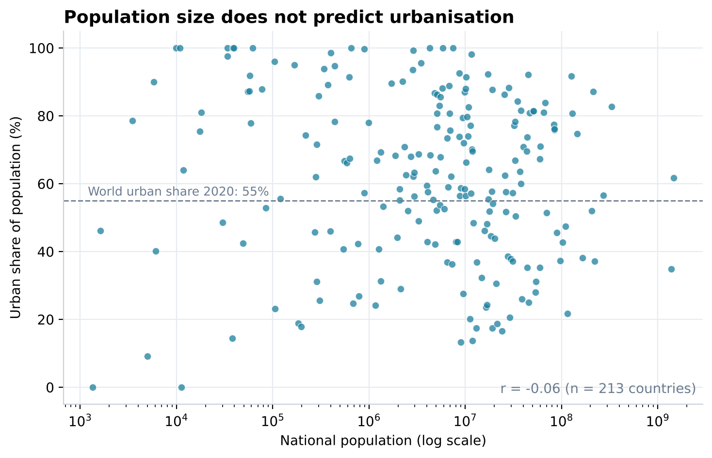

**4. Access by area: central tendency and spread** (`access_by_area_summary_stats.csv`). For all 12 features (4 service levels x national, rural, urban) I computed max, min, mean, median, mode, Q1, Q3, IQR and standard deviation, and drew a box-and-whisker chart.

| Basic access | National | Rural | Urban |
|---|---:|---:|---:|
| Mean (%) | 89.9 | 81.3 | 94.7 |
| Median (%) | 97.3 | 90.7 | 98.1 |
| IQR (points) | 14.2 | 34.3 | 7.4 |

Mean below median and mode = 100 show a left-skewed distribution: most countries sit near full access, with a long tail of low-access countries.

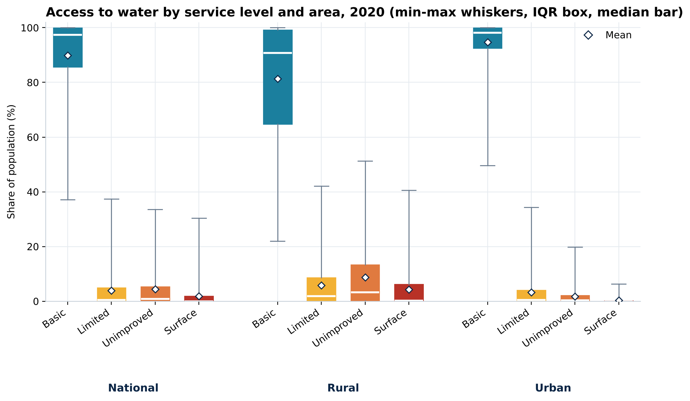
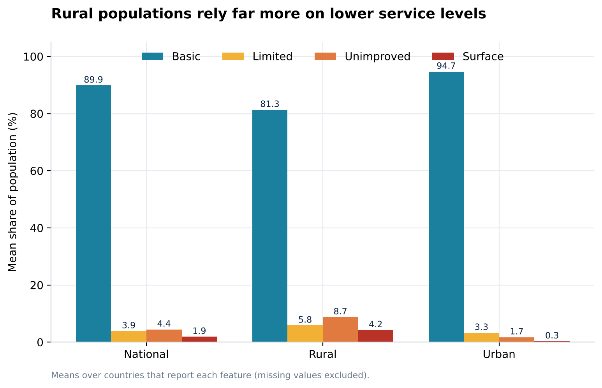

**5. Access by population size and urbanisation.** 100% stacked column charts of the four service levels against population size and against urban or rural population share (ordered x-axes; shares binned to keep bars readable). Access tracks how rural a country is, not how large it is.

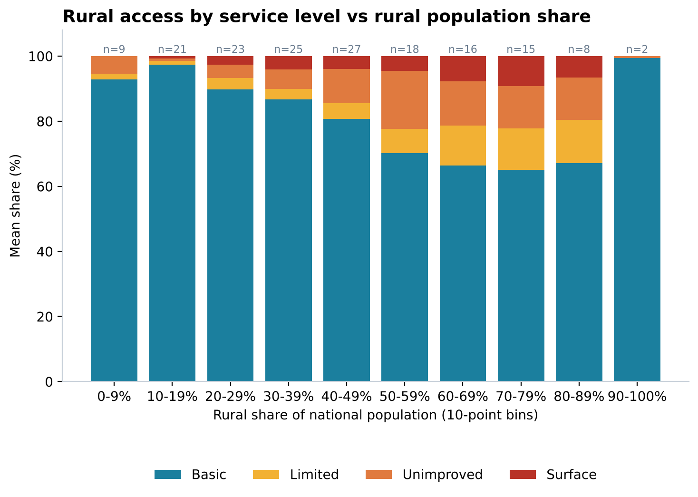

**6. Access by income group.** Pivot table on `income_group` (sum of population, average urban share, average of each service level), with income groups coded 0 to 4 so axes sort sensibly.

| Income group | Countries | Avg urban share (%) | Basic | Limited | Unimproved | Surface |
|---|---:|---:|---:|---:|---:|---:|
| Low income | 26 | 36.0 | 62.8 | 16.6 | 15.2 | 5.4 |
| Lower middle income | 52 | 48.8 | 82.2 | 5.7 | 7.9 | 4.3 |
| Upper middle income | 49 | 64.7 | 96.4 | 1.6 | 1.5 | 0.6 |
| High income | 70 | 79.4 | 99.6 | 0.2 | 0.2 | 0.0 |

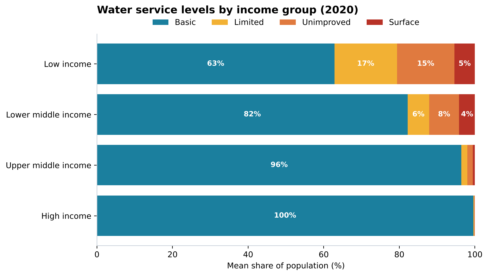

### Part 2: change between 2015 and 2020

**1. Year representation.** Sorted by `name` then `year` (an advanced range sort, so the header row stays put), built `y_diff = year(n+1) - year(n)` guarded by a same-country `IF`, removed duplicate rows (`y_diff = 0`), and charted the `year` column. Average gap: **4.8 years** (min 1, max 5). The histogram has two peaks (2015 and 2020).

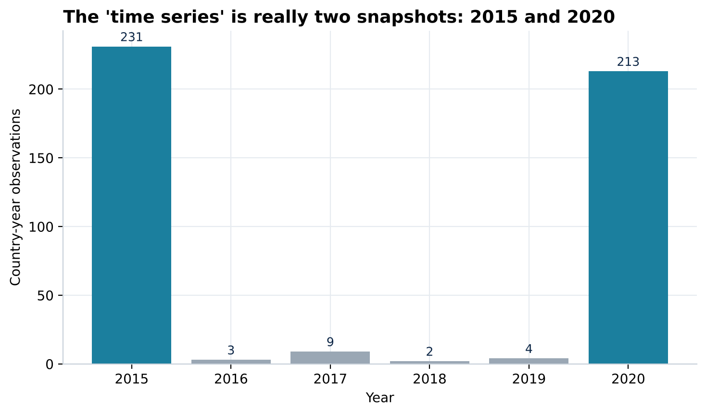

**2. Annual Rate of Change (ARC).**

```
ARC_x = (wat_bas_x(n+1) - wat_bas_x(n)) / (year(n+1) - year(n))   for x in {n, r, u}
=IFERROR( IF($A3=$A2, (E3-E2)/($B3-$B2), ), "null" )
```

The same-country test stops ARC crossing from one country to the next; mixed absolute/relative references let one formula serve national, rural and urban; `IFERROR` labels missing estimates as `null` instead of `#VALUE!`.

| ARC (pp per year) | Average | Median | Min | Max |
|---|---:|---:|---:|---:|
| National | 0.28 | 0.08 | -1.02 | 2.75 |
| Rural | 0.48 | 0.29 | -1.23 | 2.67 |
| Urban | 0.15 | 0.03 | -1.62 | 2.67 |

A higher *average* ARC does not by itself mean more progress, because countries already at 100% contribute zeros. So I also counted countries at **full access** (rounded basic access of 100 in both years) separately.

**3. Direction of change** (`arc_status_counts.csv`). Each country falls into exactly one bucket, and the buckets sum to 231.

| Area | Full access | Improving (ARC > 0) | No change (ARC = 0) | Declining (ARC < 0) | Missing ARC | Total |
|---|---:|---:|---:|---:|---:|---:|
| National | 62 | 135 | 16 | 16 | 2 | 231 |
| Rural | 29 | 116 | 5 | 17 | 64 | 231 |
| Urban | 55 | 93 | 7 | 26 | 50 | 231 |

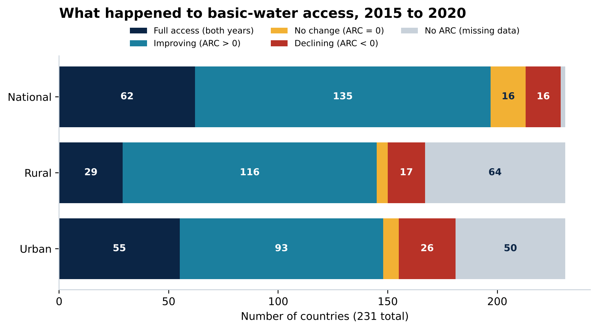

**4. Rural vs urban gap.** `ARC_diff = ARC_r - ARC_u` for the 165 countries with both values. Rural gained faster in 68% of them. Largest gaps: **Morocco** (rural +2.63 vs urban +0.31 pp/yr) and **South Sudan** (rural -0.63 vs urban +1.86).

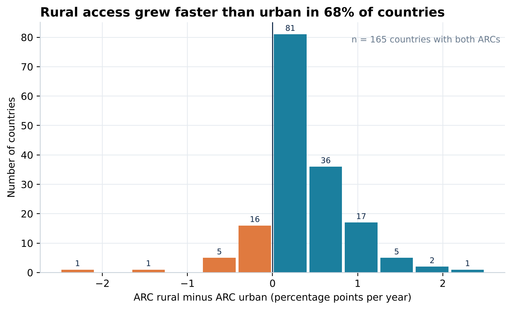

**5. Regional progress.** Added `region` with a `LOOKUP` on country name against the supplied mapping, then summarised ARC by region.

| Region | Countries | Avg ARC national | Avg ARC rural | Avg ARC urban | Avg basic access, end year (%) |
|---|---:|---:|---:|---:|---:|
| Sub-Saharan Africa | 53 | 0.56 | 0.60 | 0.27 | 70.4 |
| South Asia | 11 | 0.48 | 0.56 | 0.27 | 92.8 |
| Middle East & North Africa | 10 | 0.35 | 0.74 | 0.12 | 92.1 |
| East Asia & Pacific | 40 | 0.28 | 0.51 | 0.23 | 93.1 |
| Latin America & Caribbean | 48 | 0.14 | 0.68 | 0.07 | 96.9 |
| Europe & Central Asia | 64 | 0.11 | 0.22 | 0.05 | 97.8 |
| North America | 5 | 0.02 | 0.14 | 0.00 | 98.1 |

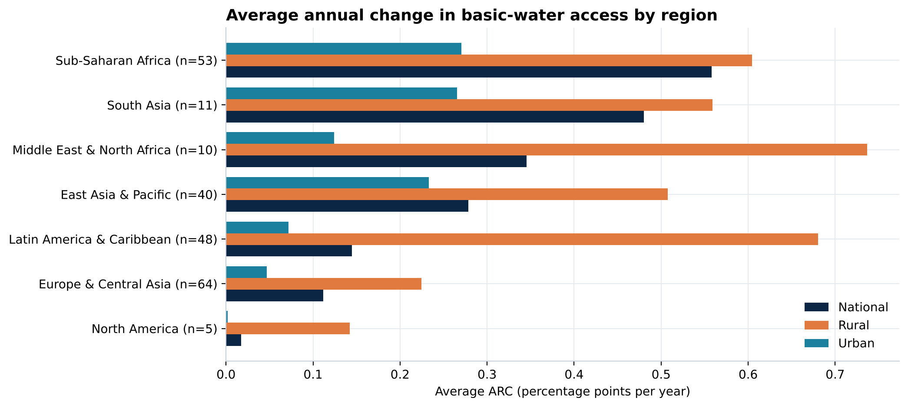
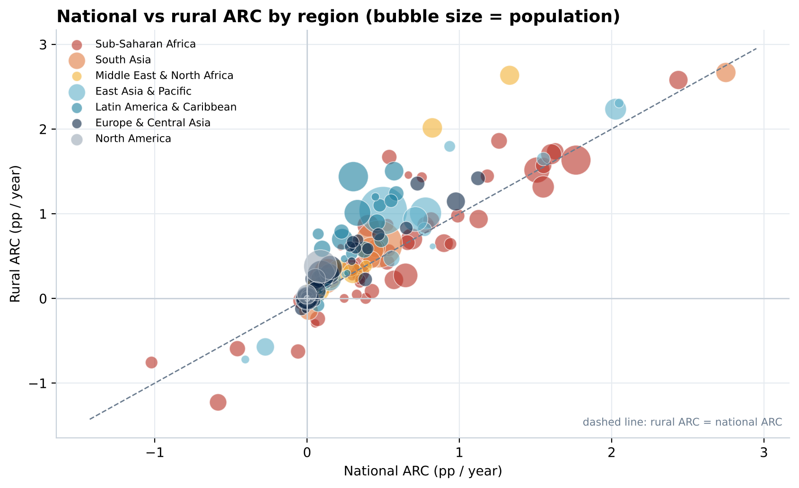

**Extension, an illustrative projection.** Extrapolating each region's average national ARC linearly from its end-year basic access suggests Sub-Saharan Africa would need roughly **53 more years** at the 2015 to 2020 pace, against about 15 to 25 for most other regions. This is a signal about relative urgency, not a forecast (linear, unweighted averages; see the notes below).

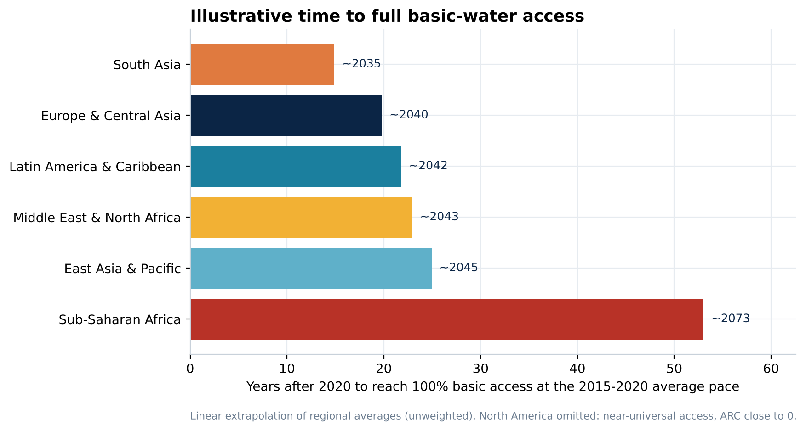

---

## Verification and data-quality notes

I rebuilt every metric in Python (`scripts/run_analysis.py`) and compared it with the value stored in the workbooks: **84 of 84 checks match** (`data/validation_checks.csv`). Along the way I recorded the following, and the deck uses the corrected figures.

---

## Reproduce it

```bash
pip install -r requirements.txt
python scripts/run_analysis.py      # regenerates data/*.csv, summary_metrics.json and plots/reproduced/*.png

npm install                         # pptxgenjs + sharp
node scripts/build_deck.js          # rebuilds presentation/water-access-portfolio-deck.pptx
```

## Tools and skills demonstrated

Google Sheets (COUNTA, IF/IFERROR, LOOKUP, QUARTILE, ROUNDUP, COUNTIFS, pivot tables, native charts) | data cleaning and validation | feature engineering | descriptive statistics (central tendency, spread, skew, correlation) | time-change metrics (ARC) | data visualisation | Python (pandas, NumPy, matplotlib) | storytelling and presentation design.

## Sources and credits

- **Data:** WHO/UNICEF Joint Monitoring Programme for Water Supply, Sanitation and Hygiene (JMP), *Estimates on the use of water*. World population and urbanisation reference values (7.821 bn; 55% urban in 2020) come from the project brief (UN-Habitat *World Cities Report 2020*).
- **Project brief:** ExploreAI Academy, *Integrated project: Access to drinking water*. The brief's slide PDFs are the academy's material and are intentionally **not** included in this repository.
